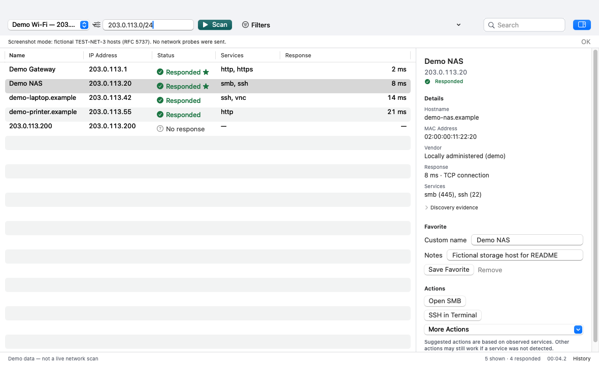
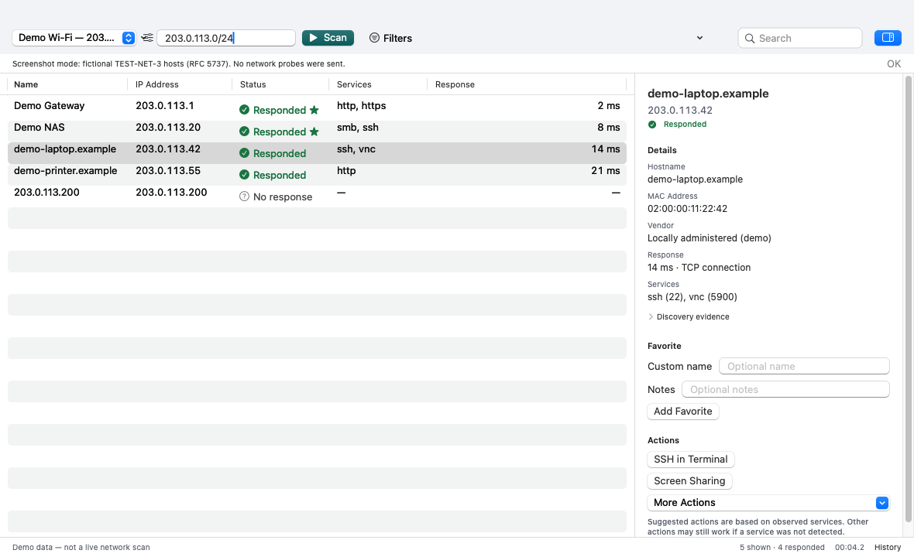
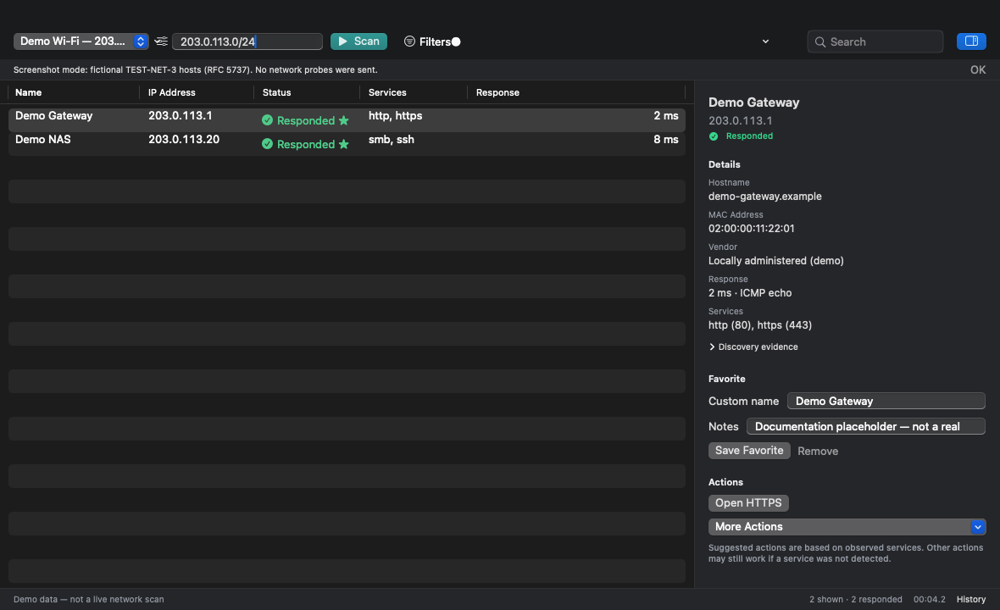

# Open LAN Scanner

Native, open-source **macOS LAN scanner**. Scan local IPv4 ranges, review live hosts, and open common remote actions — without accounts, cloud backends, or Electron.

**Not affiliated with Advanced IP Scanner or Famatech.**

<p align="center">
  
</p>



<p align="center"><em>Main window — interface → target → Scan, results table, and inspector. Demo data (RFC 5737 TEST-NET-3); no live network scan.</em></p>

| | |
|---|---|
| **Platform** | macOS 14.0+ (Apple Silicon and Intel when you build for that architecture) |
| **Stack** | Swift, SwiftUI, AppKit table, Network.framework |
| **License** | MIT |
| **Status** | Early public release (`0.x`) |

## Features

- Interface picker with readable name, local IP, and subnet; CIDR, ranges, and single IPv4 targets
- Host discovery separate from service probes (TCP open/refuse, optional ICMP, best-effort Bonjour)
- Bounded concurrent scanning with cancel, progress, live results, and progressive enrichment
- Columns: status, IP (numeric sort), display name, MAC, vendor, probe latency, services — multi-select and copy
- Filters: search, online-only, favorites; empty states with recovery actions
- Actions: SMB, HTTP/HTTPS, SSH, VNC, RDP (if a client is installed), Wake-on-LAN, Ping, Traceroute
- Favorites with notes; CSV/JSON export for all, filtered, or selected rows
- Local scan history with conservative compare; OUI import to Application Support
- Local preferences only — no telemetry or cloud backend

## Install (releases)

1. Download the `.dmg` (preferred) or `.zip` from the [latest GitHub Release](https://github.com/rallyrat/open-lan-scanner/releases).
2. Open the disk image and drag **Open LAN Scanner** into **Applications**.
3. If macOS blocks launch on an **unsigned / ad-hoc** build: right-click the app → **Open** → **Open**. Do not disable Gatekeeper globally.
4. Verify checksums when provided:

```bash
shasum -a 256 -c SHA256SUMS.txt
```

## First scan

1. Select a network interface (non-VPN preferred when listed).
2. Confirm the suggested range or enter CIDR / `a.b.c.d-e`.
3. Click **Scan**. Stop anytime with **Stop** or ⌘.
4. Use the inspector or context menu for host actions.

### Permissions

| Permission | When |
|---|---|
| **Local Network** (macOS 15+) | First LAN probe / Bonjour use — allow in System Settings → Privacy & Security → Local Network if scans find nothing |
| Apple Events / Automation (optional) | Opening Terminal for Ping / SSH |

## Requirements

- **macOS 14.0+**
- Full **Xcode** app (not Command Line Tools alone) for local builds
- Architecture: build produces **arm64**, **x86_64**, or **universal** depending on the host/`ARCHS`; release artifact names are derived from the binary via `lipo`

## Signing status

| Build | Meaning |
|---|---|
| Ad-hoc / unsigned | Default local and CI without secrets. Gatekeeper warns; use right-click → Open. |
| Developer ID signed | Requires `MACOS_CERTIFICATE_*` secrets. Still not Gatekeeper-trusted until notarized. |
| Notarized | Requires Apple ID notarization secrets. Release notes never claim notarization when it was skipped. |

Ordinary `swift build` / `./Scripts/build-app.sh` never requires Apple credentials.

## Limitations

- A failed probe does **not** prove a host is offline (“No response” / “Not observed”).
- Neighbor-cache MACs alone are not treated as proof a device is currently online.
- Interface binding uses supported Network.framework constraints; some routes cannot be forced — the UI explains this.
- Bonjour discovery is best-effort and often hostname-oriented; it is not a complete inventory.
- Response times are **TCP connect probe** latency unless an ICMP sample succeeds.
- Windows remote shutdown and Radmin are **not** supported ([notes](Docs/REMOTE_SHUTDOWN.md)).
- Early `0.x` software — expect rough edges.
- README screenshots use explicit demo data, not a live LAN capture.

## Build from source

```bash
export DEVELOPER_DIR=/Applications/Xcode.app/Contents/Developer
export BUILD_PATH=/tmp/open-lan-scanner-build
git clone https://github.com/rallyrat/open-lan-scanner.git
cd open-lan-scanner
chmod +x Scripts/*.sh
swift test --build-path "$BUILD_PATH"
./Scripts/build-app.sh
open dist/OpenLANScanner.app
```

Package ZIP + DMG locally:

```bash
CREATE_DMG=1 ./Scripts/package-release.sh
```

## Documentation

- [Architecture](Docs/ARCHITECTURE.md)
- [Feature parity](Docs/FEATURE_PARITY.md)
- [Distribution, sandbox, signing](Docs/DISTRIBUTION.md)
- [Maintainer guide](Docs/MAINTAINERS.md)
- [Contributing](CONTRIBUTING.md)
- [Security](SECURITY.md)
- [Changelog](CHANGELOG.md)
- [Design](DESIGN.md)
- [Third-party notices](THIRD_PARTY_NOTICES.md)

## OUI vendor data

A small verified sample OUI table is bundled (compact CSV). Import a larger IEEE MA-L / assignment CSV from **Preferences → Vendor database**, or:

```bash
./Scripts/download-oui.sh
```

Imported data is stored under Application Support and kept if a later import fails. See [THIRD_PARTY_NOTICES.md](THIRD_PARTY_NOTICES.md) before redistributing large IEEE datasets. Nothing uploads your network data.

## Screenshots

Captured from the real app UI with `--demo-ui` (fictional TEST-NET-3 hosts). They illustrate layout and actions only — not accessibility sign-off or authorized live-network testing.



<p align="center"><em>Inspector — display name, details, favorite editing, and service-suggested actions. Demo data.</em></p>



<p align="center"><em>Favorites filter in dark appearance with adaptive status colors. Demo data.</em></p>

Regenerate locally (no network probes):

```bash
./Scripts/export-demo-screenshots.sh
```

GitHub social preview: [`Docs/assets/github-social-preview.png`](Docs/assets/github-social-preview.png).

## CI

Workflows live in [`.github/workflows/`](.github/workflows/) (`ci.yml`, `release.yml`). Templates also remain under [`Docs/github-workflows/`](Docs/github-workflows/). Tag `v*` releases validate `VERSION`, run tests, package ZIP/DMG, optionally sign/notarize, then regenerate checksums on final bytes.

## License

MIT — see [LICENSE](LICENSE).
